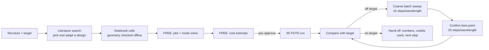

# Tidy3D Photonics Design — a Claude skill for integrated-photonics simulation

A skill that turns Claude into a disciplined simulation partner for integrated photonics.
You name a structure and what you need — *"2×2 MMI, 50/50 at 1550 nm"*, *"ring resonator
with a 20 nm 2D-material flake on top, I need Q and added loss"* — and Claude runs the same
research-grade loop every time:

1. **Literature first** — finds the current best designs for that device class, compares
   them, and adapts the chosen one to *your* platform (thickness, cladding, wavelength).
2. **Ready-to-run Tidy3D notebook** — complete cells you paste or upload into Tidy3D's
   browser notebook, with the geometry checked before you see it.
3. **Staged, credit-aware runs** — free geometry and mode checks, then a cost estimate,
   and only then a paid 3D FDTD run.
4. **Optimization** — a coarse batch sweep on a cheaper mesh, then one full-resolution
   confirmation run.
5. **Honest interpretation** — comparison tables, physical explanations of discrepancies,
   and a clear recommendation for the next run and its cost.



## Why

Commercial-grade 3D electromagnetic simulation is now available to academics on a credit
budget (for example Tidy3D's education plans). That makes two things matter more than
ever: **not wasting credits on badly set-up runs**, and **not trusting simplified models**
for devices that need full 3D. This skill encodes both.

A real example from building it: a compact 2×2 MMI that a 2D effective-index
beam-propagation model predicted to split 50/50 came out **66/34 in full 3D FDTD**, and a
five-point length sweep (about 2 FlexCredits) showed the balance point lay on the opposite
side of where intuition suggested. That kind of correction is exactly what the workflow is
built to catch before fabrication.

## Repository contents

| Path | What it is |
|---|---|
| `tidy3d-photonics-design/SKILL.md` | The skill itself — the instructions Claude follows |
| `examples/mmi_2x2_example.ipynb` | Example notebook: 2×2 MMI on 220 nm SOI (upload to Tidy3D) |
| `examples/mmi_2x2_example.py` | Same example as a script with `# %%` cell markers |
| `tools/check_geometry.py` | Checks a notebook's 2D layout **without** installing tidy3d (numpy + matplotlib only) |
| `tools/py_to_ipynb.py` | Converts a `# %%` script into a Jupyter notebook |
| `docs/mmi_2x2_example_geometry.png` | Output of the geometry check for the example |

## Requirements

- **Claude** with skills support (Claude Code, or a Claude app that lets you add custom skills).
- **A Tidy3D account** from Flexcompute. Academics can apply for an education license with
  free monthly FlexCredits. The browser notebook ("Use Python Interface") has tidy3d
  preinstalled, so nothing needs to be installed on your computer.
- Optional: Flexcompute's Tidy3D MCP plugin, if you want Claude to submit simulations itself
  instead of handing you notebook cells.

## Installation

**Claude Code:** copy the skill folder into your personal skills directory:

```bash
git clone https://github.com/Ghada Dushaq/tidy3d-photonics-skill.git
mkdir -p ~/.claude/skills
cp -r tidy3d-photonics-skill/tidy3d-photonics-design ~/.claude/skills/
```

or into a project's `.claude/skills/` folder to share it with collaborators on that project.

**Claude apps:** zip the `tidy3d-photonics-design` folder and add it as a custom skill
(see Anthropic's documentation at [docs.claude.com](https://docs.claude.com) for the
current steps on your plan).

## Using it

Just describe the device; Claude asks only for what is missing (always including the
cladding). For example:

> Directional coupler, 50/50 at 1550 nm, 220 nm SOI, oxide-clad, TE.

> SiN ring, 800 nm thick, air-clad, with a 30 nm flake of a 2D material on top — I need the
> loaded Q and the added loss. Here are my measured n,k values.

> Grating coupler for TE at 1550 nm on my platform, target −3 dB peak, 1 dB bandwidth ≥ 30 nm.

## Running the example

1. Log in to Tidy3D → **Use Python Interface** → upload `examples/mmi_2x2_example.ipynb`.
2. Run cells 1–5 (free): geometry plots, a local mode solve (TE0 n_eff ≈ 2.33 for the
   440 × 220 nm port) and the cost estimate.
3. Run cell 6 (about 1–1.5 FlexCredits maximum) and cell 7 for the results table and plots.
4. Optional: cells 8A (free, prints the sweep cost) and 8B (runs a 5-point coarse length sweep).

The example's MMI length is an **analytic starting point, not an optimized design** — finding
the 3D optimum with the sweep is the point of the exercise.

## Credit strategy built into the skill

| Rule | Why |
|---|---|
| Nothing paid runs before you see the estimate | Estimates are free; mistakes are not |
| Free local mode solve before any FDTD | Catches wrong stacks and dimensions instantly |
| Mirror symmetry when the cladding allows it | Roughly halves the cost |
| Coarse sweep at 15 steps/wavelength, confirm at 20 | Coarse results stayed within ~2% for the MMI at a fraction of the cost |
| Trim the domain if one run estimates > ~3 FC | Window, fan-outs and mesh are usually oversized |
| Running total of billed credits | Keeps a monthly allowance under control |

## Lessons encoded in the skill

- Always confirm the cladding; it changes beat lengths, symmetry and cost.
- Fan closely spaced ports out with S-bends before placing mode sources and monitors.
- Run waveguide leads through the PML; keep sources and monitors clear of it.
- Use z-symmetry only for vertically symmetric cladding.
- Treat 2D effective-index results (BPM and similar) as starting points for self-imaging and
  coupling-length devices; confirm in 3D.
- Harmless warnings (an unguided mode not decaying at the mode-plane edge; intermediate
  "near PML" warnings while building sweeps) are explained, not ignored.

## Limitations

- Claude cannot always install tidy3d in its own workspace, so notebook code is checked with
  `tools/check_geometry.py` and syntax checks before you run it — the Tidy3D calls themselves
  are first executed on your account. Report any error back to Claude and it will fix it.
- Results are only as good as the materials data and mesh; validate against one measured
  device before trusting a new platform.
- The EME solver path for very cheap length sweeps is recommended but not yet part of the
  verified templates.

## Disclaimer

This is an independent, community project. It is not affiliated with, endorsed by or
supported by Flexcompute (Tidy3D) or Anthropic (Claude). Tidy3D is a product and trademark
of Flexcompute Inc.; the Tidy3D Python client is open source under LGPL-2.1. Simulation
results are your responsibility to validate before fabrication.

## Author and license

Created by **Ghada Dushaq**. Released under the [MIT License](LICENSE).
Issues, improvements and new device templates are welcome via pull requests.
